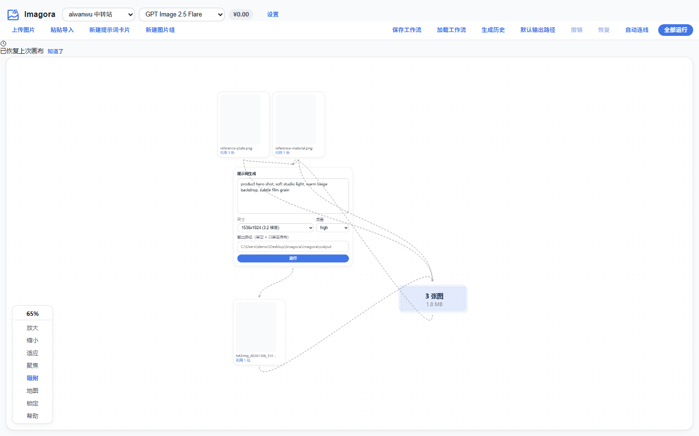
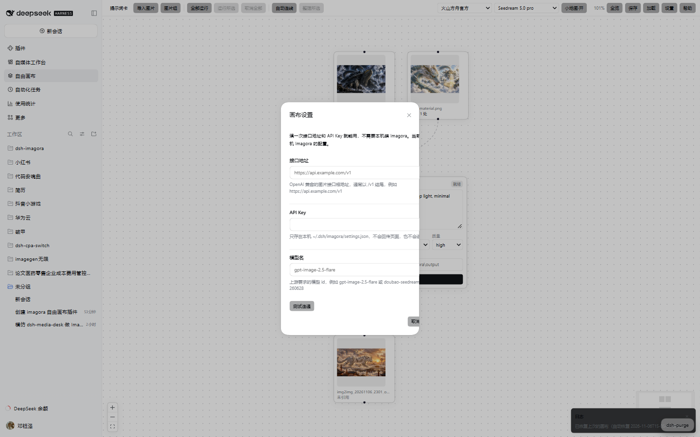

# dsh-imagora-desk

[](https://github.com/cslkkl/dsh-imagora-desk/actions/workflows/ci.yml)
[](LICENSE)
[](.node-version)
[](https://github.com/cslkkl/dsh-imagora-desk/releases)

把 [Imagora](https://github.com/Cogniform/imagora) 的**自由画布**搬进 DeepSeek Harness。
提示词卡与图片摊在一张无限画布上，**连线就是参考关系**；跑完的图自动回流成新节点。



## 为什么用它

- **画布即工作流**。不用填表单再等结果：把图拖上来，把提示词卡连上去，跑完的图直接接在下面，接着往下连。
- **不用装 Imagora**。填一次接口地址和 API Key 就能出图；两分钟从装插件到出第一张。
- **界面是原生的**。走 DSH 官方组件库，主题、暗色、焦点环、快捷键都跟宿主一致，不是一个套壳网页。
- **一眼分清主次**。三类节点各占一个色相——提示词卡紫、图片青、图片组琥珀，画布底色是极浅的双色渐变；出图状态另有运行蓝 / 成功绿 / 失败红。

## 能做什么

- 无限画布：提示词卡 / 图片 / 图片组，拖拽吸附对齐、缩放、框选、小地图、全览。
- 连线即参考：图片或图片组连到提示词就是它的参考图；提示词连到图片表示产出。
- 出图回流：单卡运行、全部运行、运行所选、取消全部；结果自动变成新节点并连线。
- 生成历史：磁盘上出过的图都在，可筛选、多选放回画布——节点删了也找得回来。
- 粘贴导入：一段 `=== 标题 ===` + `ratio:` 格式的清单，一次建出多张提示词卡。
- 点名引用：提示词里写 `@图片名` 只挑指定的图，不写就用入边上的全部图片。
- 工作流：手动命名保存与加载；画布改动还会自动落一份恢复快照（留最近 5 份）。
- 与 Imagora 同键位：`Ctrl+A` 全选、`Ctrl+Z/Y` 撤销恢复、`Ctrl+S` 保存、`Del` 删除。

## 安装

```powershell
# 插件市场里点安装等价于这条（发布到 npm 后可用）
dsh plugin --profile web add dsh-imagora-desk

# 或直接用本仓库的 Release 包
dsh plugin --profile web add https://github.com/cslkkl/dsh-imagora-desk/releases/download/v0.1.0/dsh-imagora-desk-0.1.0.tgz
```

装完刷新页面。左侧面板列表出现「自由画布」；若没有，重启一次 `dsh web`（页面的 client 清单在启动时计算）。

## 第一次用

打开画布会**自动弹出设置**（没配置的时候）：



1. **接口地址** — OpenAI 兼容的图片接口根地址，通常以 `/v1` 结尾。
2. **API Key** — 只存在本机，不回传页面、不进日志。
3. **模型名** — 上游要求的模型 id。

点「测试连通」会读一次上游模型清单（**不生成图、不花钱**），读到的模型可直接点选。
保存后即可建卡、连线、出图。

已经有 Imagora 的话也可以不填：设置弹窗里能切回「本机 Imagora 的配置」，沿用它的来源、模型与价目表。
同一处还能改**默认输出路径**——留空就用来源根目录下的 `output`。

## 常用操作

| 操作              | 说明                                                           |
| ----------------- | -------------------------------------------------------------- |
| 提示词卡 / 图片组 | 工具栏新建，或在工具栏把按钮拖到画布上落点                     |
| 导入图片          | 「导入图片」，或把图拖进画布、在画布上 `Ctrl+V`                |
| 粘贴导入提示词    | 一段 `=== 标题 ===` + 围栏 + `ratio: 3:2` 的清单，一次建多张卡 |
| 运行              | 单卡「运行」；工具栏「全部运行」「运行所选」「取消全部」       |
| 生成历史          | 磁盘上出过的图，筛选后多选放回画布                             |
| 保存 / 加载       | 手动命名存工作流；改动另有自动恢复快照（留最近 5 份）          |

## 快捷键

| 键位                                    | 作用                                     |
| --------------------------------------- | ---------------------------------------- |
| `Ctrl/Cmd + A`                          | 全选节点                                 |
| `Ctrl/Cmd + Z`                          | 撤销                                     |
| `Ctrl/Cmd + Y` · `Ctrl/Cmd + Shift + Z` | 恢复                                     |
| `Ctrl/Cmd + S`                          | 保存工作流                               |
| `Delete` / `Backspace`                  | 删选中的节点；没选节点时删选中的那条连线 |
| `Escape`                                | 关掉大图预览                             |
| 滚轮 · 左键拖空白 · `Shift`+拖          | 缩放 · 平移画布 · 框选                   |
| 双击图片                                | 放大预览                                 |

在输入框里打字时这些键位不生效，交回浏览器原生行为。

## 数据边界

- 请求直连你自己填的接口，没有中转服务。
- 密钥只写本机 `~/.dsh/imagora/settings.json`（权限 600），接口只回「是否已配置」。
- 图片、工作流、恢复快照全部落在 `~/.dsh/imagora/` 下，可随时整个删掉。

## 与 Imagora 的差距

画布主干一致，差距集中在图片加工（裁剪 / 切分 / 放大 / 蒙版）与几个效率辅助功能。
逐项对照见 [docs/FEATURE-PARITY.md](docs/FEATURE-PARITY.md)。

## 开发

需要 Node 24.15.0（见 [.node-version](.node-version)）与 pnpm。

```powershell
pnpm install
pnpm run build        # 打 dist/client.js；改完源码必须重跑
pnpm run test         # 两套冒烟：host 接口 30 项 + bundle/包名/插槽 13 项
pnpm run harness      # 渲染验收台 http://127.0.0.1:4319/（mock 数据，不花钱）
```

- 全部命令与检查选择 → [AGENTS.md](AGENTS.md)
- 设计不变量与接口契约 → [docs/ARCHITECTURE.md](docs/ARCHITECTURE.md)
- 发布到 npm 与市场收录 → [docs/PUBLISHING.md](docs/PUBLISHING.md)

## 许可

MIT。`src/client/lib/` 移植自 Imagora（MIT），画布交互层用 React Flow（MIT），
详见 [THIRD_PARTY_NOTICES.md](THIRD_PARTY_NOTICES.md)。

问题与建议走 [Issues](https://github.com/cslkkl/dsh-imagora-desk/issues)。
