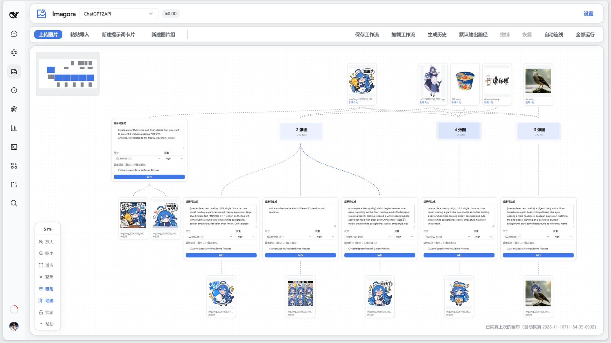

<div align="center">


<h1>dsh-imagora-desk</h1>

<p>
  <a href="https://github.com/cslkkl/dsh-imagora-desk/actions/workflows/ci.yml"></a>
  <a href="LICENSE"></a>
  <a href=".node-version"></a>
  <a href="https://github.com/cslkkl/dsh-imagora-desk/releases"></a>
</p>

<p><b>把 <a href="https://github.com/Cogniform/imagora">Imagora</a> 的自由画布搬进 DeepSeek Harness</b></p>

<p>提示词卡与图片摊在一张无限画布上，<b>连线就是参考关系</b>；跑完的图自动回流成新节点，接着往下连。<br>
不用装 Imagora，填一次接口地址和 API Key 就能出图。</p>

</div>

> **数据边界**　请求直连你自己填的接口，没有中转服务；密钥只写本机；图片、工作流与恢复快照全落在本地目录，可随时整个删掉。

## 界面一览



## 能做什么

- **画布即工作流**：不用填表单再等结果。把图拖上来、把提示词卡连上去，跑完的图直接接在下面。
- **连线即参考**：图片或图片组连到提示词就是它的参考图；提示词连到图片表示产出。提示词里写 `@图片名` 只挑指定的图。
- **三种跑法**：单卡运行、全部运行、运行所选；随时取消。结果回流成新节点并自动连线。
- **选中操作栏**：运行所选 / 自动整理（按参考关系分层重排，其余原位）/ 自动连线 / 设输出路径 / 删除所选。
- **图片加工**：图片节点右键 → 裁剪 / 切分 / 放大 / 蒙版重绘，全部本地处理，不花钱。
- **生成历史**：读磁盘上的账本，可搜索、按状态筛选、看花费与成功率，多选放回画布——节点删了也找得回来。
- **粘贴导入**：一段 `=== 标题 ===` + `ratio: 3:2` 的清单，一次建出多张提示词卡，格式不对的地方逐条标红。
- **工作流**：手动命名保存与加载；画布改动另存一份自动恢复快照（留最近 5 份）。
- **观感是原生的**：走 DSH 组件库，主题、暗色、焦点环都跟宿主一致；画布与节点照搬 Imagora 的设计层，配色随主题。

## 安装

**最快的方式：加一个索引源，然后在插件市场里搜「imagora」。**

`插件 → 发现 → 切换插件索引 → 管理索引源…`，粘贴：

```text
https://toolboxonline.online/dsh-imagora-desk/index.json
```

也可以直接用命令行装：

```powershell
# 从仓库源码装最新
dsh plugin --profile web add git+https://github.com/cslkkl/dsh-imagora-desk.git

# 或用 Release 包
dsh plugin --profile web add https://github.com/cslkkl/dsh-imagora-desk/releases/download/v0.1.0/dsh-imagora-desk-0.1.0.tgz
```

装完刷新页面，左侧面板列表出现「自由画布」。若没有，重启一次 `dsh web`（页面的 client 清单在启动时计算）。

## 第一次用

打开画布会**自动弹出设置**（没配置的时候）：

1. **接口地址** — OpenAI 兼容的图片接口根地址，通常以 `/v1` 结尾。
2. **API Key** — 只存在本机，不回传页面、不进日志。
3. **模型名** — 上游要求的模型 id。

点「测试连通」会读一次上游模型清单（**不生成图、不花钱**），读到的模型可直接点选。保存后即可建卡、连线、出图。

已经有 Imagora 的话也可以不填：设置里能切回「本机 Imagora 的配置」，沿用它的来源、模型与价目表；
同一处还能改**默认输出文件夹**，留空就用来源根目录下的 `output`。工具栏那颗「默认输出文件夹」
点下去直接弹系统目录对话框，卡片上也有同一枚按钮。

## 快捷键

| 键位                                    | 作用                                     |
| --------------------------------------- | ---------------------------------------- |
| `Ctrl/Cmd + A`                          | 全选节点                                 |
| `Ctrl/Cmd + Z`                          | 撤销                                     |
| `Ctrl/Cmd + Y` · `Ctrl/Cmd + Shift + Z` | 恢复                                     |
| `Ctrl/Cmd + S`                          | 保存工作流                               |
| `Delete` / `Backspace`                  | 删选中的节点；没选节点时删选中的那条连线 |
| `Escape`                                | 关掉大图预览                             |
| 滚轮 · 左键拖空白                       | 缩放 · 平移画布                          |
| 右键拖拽                                | 框选（与 Imagora 同手势）                |
| 右键单击节点                            | 弹出该节点的操作菜单                     |
| 双击图片                                | 放大预览                                 |

在输入框里打字时这些键位不生效，交回浏览器原生行为。

## 和原版 Imagora 共用一份数据

设置里填上 Imagora 目录（含 `config.json` 的那个文件夹），插件就**直接读写它那一份**，不复制、不建快捷方式：

- 接口地址、密钥、模型：读它的 `config.json` / `providers.local.json` / `.env`。
- 工作流：读写它的 `output/workflows/`；生成历史读它的账本 `logs/generation.jsonl`。
- 预算：与本机那份 `.budget.json` 共读，两边改都立刻可见。

目录留空就只用插件自己的 `~/.dsh/imagora/`，两者互不影响，随时可以在设置里切回去。

功能面已与上游对齐，逐项对照见 [docs/FEATURE-PARITY.md](docs/FEATURE-PARITY.md)。

## 开发

需要 Node 24.15.0（见 [.node-version](.node-version)）与 pnpm。

```powershell
pnpm install
pnpm run build        # 打 dist/client.js；改完源码必须重跑
pnpm run test         # host 接口 113 项 + bundle/包名/插槽 25 项
pnpm run test:ui      # 真实浏览器跑验收台 58 项（找不到浏览器则 SKIP）
pnpm run harness      # 渲染验收台 http://127.0.0.1:4319/（mock 数据，不花钱）
```

- 全部命令与检查选择 → [AGENTS.md](AGENTS.md)
- 设计不变量与接口契约 → [docs/ARCHITECTURE.md](docs/ARCHITECTURE.md)
- 市场收录与发版 → [docs/PUBLISHING.md](docs/PUBLISHING.md) · [docs/RELEASE.md](docs/RELEASE.md)

## 许可

MIT。`src/client/lib/` 移植自 Imagora（MIT），画布交互层用 React Flow（MIT），
详见 [THIRD_PARTY_NOTICES.md](THIRD_PARTY_NOTICES.md)。

问题与建议走 [Issues](https://github.com/cslkkl/dsh-imagora-desk/issues)。
